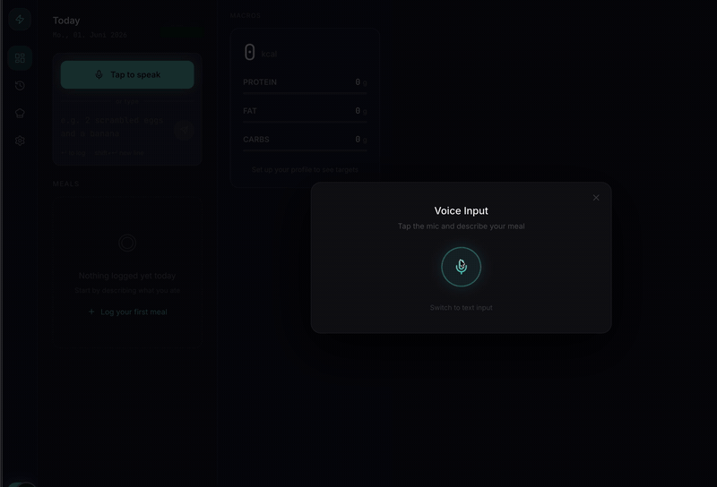
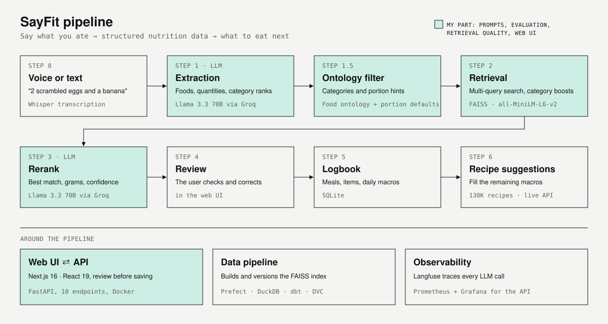
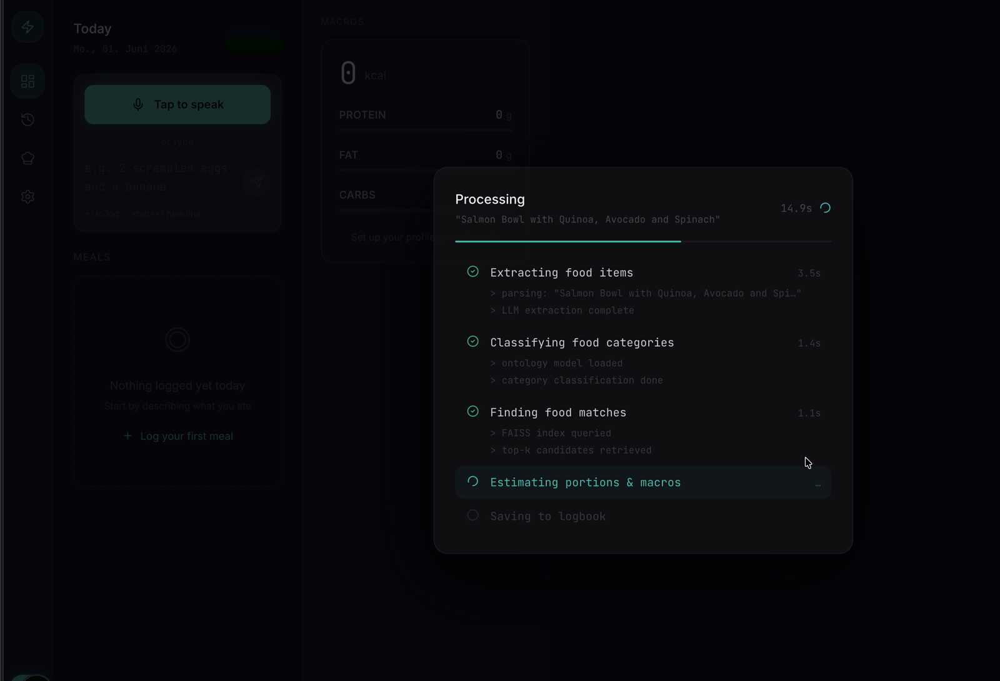
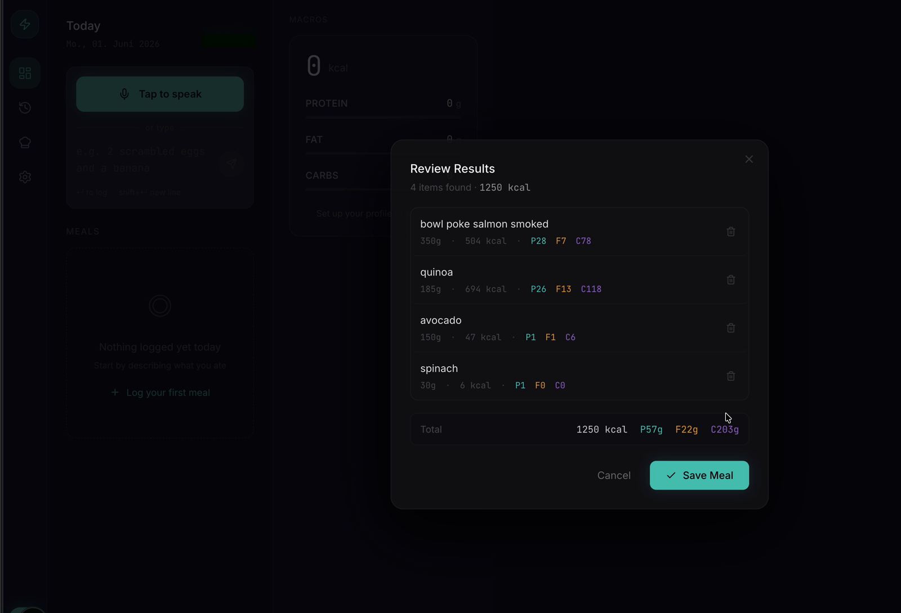
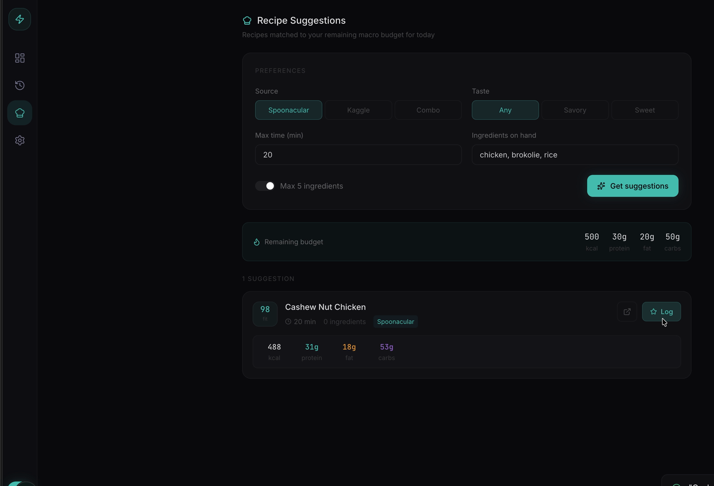
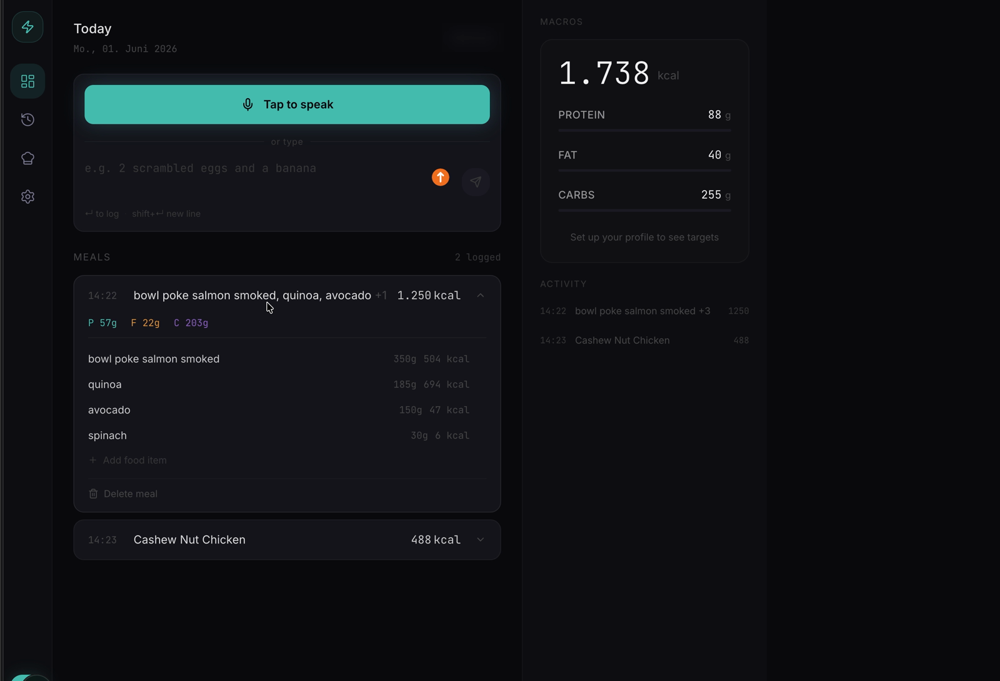

# SayFit

**Say what you ate. SayFit turns it into structured nutrition data, logs it and suggests what to eat next.**



SayFit was the capstone project of the AI Engineering bootcamp at neue fische (11/2025 – 06/2026), built by a team of four. The full product (data pipeline, API, recipe feature) lives in the team repository **[KevinSchmitt1/sayfit-alpha](https://github.com/KevinSchmitt1/sayfit-alpha)**.

This repository shows **my part**: the web UI, and the work on retrieval quality and on the two LLM stages.

Demo in better quality: [media/sayfit-demo.mp4](media/sayfit-demo.mp4) (25 s, no sound).

## How it works



1. **Voice or text.** Whisper transcribes the spoken meal.
2. **Extraction (LLM).** The first LLM call turns the sentence into food items, quantities and category ranks.
3. **Ontology filter.** Categories and portion hints are refined before the search.
4. **Retrieval.** A multi-query search over a FAISS index of nutrition data finds candidate foods, with category boosts against false matches ("peach" should not become "peach pie").
5. **Rerank (LLM).** The second LLM call picks the best match, estimates grams and reports a confidence score.
6. **Review and log.** The user checks the result in the web UI and saves it to the daily log.
7. **Recipe suggestions.** SayFit suggests recipes that fill the remaining daily macros.

## My part

- **Both LLM stages.** Prompt design and evaluation of extraction and reranking, traced in Langfuse with an end-to-end test suite. From prompt version 3 to version 4, end-to-end latency dropped by 23 % (16.4 s → 12.6 s) and the average confidence rose to 0.98. *Source: team presentation, June 2026.*
- **Retrieval quality.** Multi-query retrieval and the category filter.
- **The web UI** in [`frontend/`](frontend): Next.js 16, React 19, Tailwind CSS 4. While the backend processes a meal, it shows the pipeline steps with estimated timings. Then it lets the user correct the result before saving, and shows the daily macros, the history and recipe suggestions.
- **My commits** in the team repository: [commits by RobStraubm](https://github.com/KevinSchmitt1/sayfit-alpha/commits/main?author=RobStraubm).

The web UI was developed with the help of Claude Code.

## Screens

| Processing | Review |
|---|---|
|  |  |
| **Recipe suggestions** | **Today** |
|  |  |

## Run the web UI

```bash
cd frontend
npm install
NEXT_PUBLIC_API_URL=http://localhost:8000 npm run dev
```

The UI needs the SayFit API from the [team repository](https://github.com/KevinSchmitt1/sayfit-alpha). The API needs a Groq API key and the FAISS index from the data pipeline. Without the API, the UI starts but cannot process meals.
